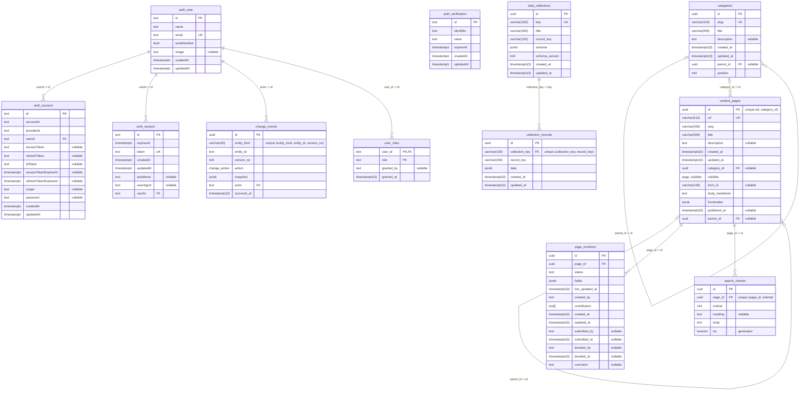

# api_v2

The markdown content API uses Node, Fastify, Drizzle and its own PostgreSQL database. Citizen page resolution stays public. The editor's reads and writes require a GitHub account with a verified email and active membership in `govtech-bb`, authenticated by BetterAuth.

## Run locally

Create `gov_bb_v2`, then copy `.env.example` to `.env` and fill in the authentication settings. `pnpm dev` loads `.env` when it exists; the built server (`pnpm start`) reads only its environment. From this directory:

```sh
pnpm dev
```

Create a [GitHub OAuth App](https://github.com/settings/developers) with homepage URL `http://localhost:3000` and this authorization callback URL:

```text
http://localhost:3020/api/auth/callback/github
```

Use `http://localhost:3000` for the editor and set its public `VITE_API_ORIGIN` to `http://localhost:3020`. Use `localhost` consistently; mixing it with `127.0.0.1` changes the browser's cookie context. The editor offers unauthenticated visitors **Continue with GitHub** and starts OAuth only when they choose it, then returns them to their original editor URL. Authentication does not move or clear existing browser drafts.

Generate `BETTER_AUTH_SECRET` with `openssl rand -base64 32` and keep it stable. Set `GITHUB_CLIENT_ID` and `GITHUB_CLIENT_SECRET` from the GitHub OAuth App. The provider requests `read:user`, `user:email`, and `read:org`; grant the app access to `govtech-bb` if the organization restricts OAuth apps. Missing credentials prevent startup in every environment.

For local development only, `AUTH_BYPASS=true` skips sign-in. BetterAuth is not started, so the credentials above are unused and placeholders will do, and every editor request runs as a fixed local developer. Pair it with the editor's `VITE_AUTH_BYPASS=true`. Under the bypass `API_V2_ADMIN_EMAILS` may be left empty, since the local developer holds every role; otherwise startup refuses without it. Because a bypassed API admits any caller, startup refuses it in production and whenever `EDITOR_ORIGIN` is not `localhost` or `127.0.0.1`, and a bypassed API listens on `127.0.0.1` only. The developer is added to `auth_user` at startup, so their edits are recorded against them. #3342 replaces the bypass with a real local session.

| Variable                                           | Purpose/default                                                                                                                                                                                                        |
| -------------------------------------------------- | ---------------------------------------------------------------------------------------------------------------------------------------------------------------------------------------------------------------------- |
| `DB_HOST`, `DB_PORT`, `DB_USERNAME`, `DB_PASSWORD` | `localhost`, `5432`, `postgres`, `postgres`                                                                                                                                                                            |
| `DB_NAME`                                          | `gov_bb_v2`                                                                                                                                                                                                            |
| `DB_SSL_CA`                                        | Optional PEM contents or CA file path; production uses verified TLS                                                                                                                                                    |
| `PORT`                                             | `3020`                                                                                                                                                                                                                 |
| `SEED`                                             | `true` loads the committed estate snapshot on boot. Local development only: an additive seed on every boot brings back a page an editor deleted, so no deployed environment may set it, and production refuses to boot |
| `BETTER_AUTH_URL`                                  | Required public API origin                                                                                                                                                                                             |
| `EDITOR_ORIGIN`                                    | Required editor origin; the exact credentialed CORS and write-origin allowlist                                                                                                                                         |
| `BETTER_AUTH_SECRET`                               | Required secret of at least 32 characters                                                                                                                                                                              |
| `GITHUB_CLIENT_ID`, `GITHUB_CLIENT_SECRET`         | Required server-side GitHub OAuth credentials                                                                                                                                                                          |
| `AUTH_BYPASS`                                      | Local development only: `true` skips sign-in (see above)                                                                                                                                                               |
| `PREVIEW_SECRET`                                   | Optional; the site's preview token. Unset, every preview read is refused                                                                                                                                               |
| `API_V2_ADMIN_EMAILS`                              | Required unless `AUTH_BYPASS=true`: comma-separated emails granted the `admin` role whenever they sign in (see Roles). Startup refuses an empty list, since without an admin nobody can grant `approver` (ADR 0079)    |
| `REVIEW_NOTIFICATIONS`                             | `off` (default), `log` or `ses`: whether review steps email people (see Review emails). `log` writes each email to the log instead, for local runs and tests; production refuses it                                    |
| `SES_FROM_ADDRESS`                                 | Required when `REVIEW_NOTIFICATIONS=ses`: the verified SES sender, as apps/api's `SES_FROM_ADDRESS`. Startup refuses `ses` without it                                                                                  |
| `SES_REGION`                                       | Optional SES region; falls back to `AWS_DEFAULT_REGION`, then `us-east-1`                                                                                                                                              |

Production requires HTTPS API/editor origins on the same site, such as separate subdomains of the same organizational domain. Cookies are host-only, HttpOnly, Secure on HTTPS, and SameSite=Lax; API requests from the editor include credentials. Do not enable broad cookie domains or permissive CORS. Register the production API's exact `/api/auth/callback/github` URI in GitHub. Forwarded Host headers do not determine callback URLs; the configured origin does. This change does not configure hosting, DNS, or a reverse proxy.

## Boundaries

`main.ts` is the composition root. It parses configuration, creates one logger and pool, connects, migrates and seeds, then constructs the adapters (`PostgresPages`, BetterAuth or the local bypass), the services over them, and the HTTP app, and on shutdown closes the app before the pool. `src/test-db.ts` composes the same graph for tests.

| Layer             | Directory                  | Owns                                                                                                                                                                               |
| ----------------- | -------------------------- | ---------------------------------------------------------------------------------------------------------------------------------------------------------------------------------- |
| Domain            | `src/modules`              | Page shapes and write rules (placement, publication), what a viewer may see, categories and what they list, service grouping, search text, auth admission. Pure: no I/O, no clock. |
| Application       | `src/services`             | One use case each (`PageResolution`, `SiteNavigation`, `PageEditing`, `CategoryEditing`, `EditorIndex`, `EditorAccess`), with the ports it needs declared beside it.               |
| Outbound adapters | `src/adapters`             | `PostgresPages` (all content SQL, including the recursive hierarchy reads), BetterAuth, the local bypass.                                                                          |
| Inbound adapters  | `src/routes`, `src/app.ts` | Zod request/response contracts, the HTTP mapping of each result.                                                                                                                   |

Category HTTP handlers live in `src/routes/categories.ts`. Its editor plugin is registered inside `src/routes/editor.ts`, so employee, Origin and no-store checks apply before validation. Its public plugin is registered inside `src/routes/site.ts`, so preview admission, cache policy and ETags remain separate from employee access. Both reuse the parent scope's request identity reader; category rules and SQL stay in their existing domain, service and storage owners.

Route plugins receive their services and request identity readers explicitly through plugin options; nothing is decorated onto the Fastify instance and nothing is autoloaded, so dependencies are visible at registration. Expected failures are `Result` values that routes map to status codes; only defects throw. ESLint enforces the direction: domain and services cannot import Fastify, drizzle, pg, BetterAuth, adapters or routes, and routes cannot import infrastructure.

Better Auth verifies the GitHub email, and the API checks `GET /user/memberships/orgs/govtech-bb` using the sign-in token on both first and returning sign-ins. Only `state: active` membership in `govtech-bb` is admitted; pending invitations, missing membership, and failed checks deny access. Any verified email domain is allowed. Password login and client-supplied ID-token sign-in are disabled. Existing users can link GitHub through the same verified email only after passing the membership check; provider trust never bypasses email verification. OAuth tokens are discarded before account persistence. Sessions expire absolutely after eight hours; reads do not extend them. Session cookies are checked against PostgreSQL on every protected request, so revocation takes effect immediately. Organization membership changes are checked on the next GitHub sign-in; existing application sessions must be revoked when immediate removal is required.

Migration `003_auth` adds BetterAuth's four core tables: `auth_user`, `auth_session`, `auth_account`, and `auth_verification`. It does not replace content tables or author data. BetterAuth reads and writes them through its Drizzle adapter, over the same tables defined in `schema.ts` (where `schema.test.ts` checks them column for column); migrations stay hand-written and replay-safe, never generated. The migration is checked against the installed BetterAuth schema in the PostgreSQL integration suite. Migration `004_github_sessions` revokes sessions without a linked GitHub account, forcing existing Google users through the new membership check. User IDs, accounts, content, audit history, and browser drafts are preserved. Use the same verified email on GitHub to retain an existing user ID.

### Roles

Signing in decides who is an employee; roles decide what they can do (ADR 0079). Roles are rows in `user_roles` (migration `008_user_roles`, numbered after #3340's 006 and 007), read on every request, so a revocation applies to the employee's next request.

- `editor` writes: creating, saving and deleting pages. Every employee is an editor by default: api_v2 grants the role, with no grantor, when it creates the user at their first sign-in, and migration `009_default_editor_role` granted it once to everyone who had signed in before. It is never granted again, so an admin can revoke it to stop one person writing without removing them from the organisation.
- `approver` changes what citizens see: changing a page's `visibility`, deleting a `public` page, rejecting or publishing a pending revision, and creating, editing, reordering and deleting categories, so landing shows only category changes an approver made (#3201). These are direct actions, with no request waiting for a second approver, except that an approver can't make public content they changed (see Making a page public). An editor who isn't an approver can make every other edit, and submit a revision for review.
- `admin` lists employees and grants and revokes roles (`/editor/employees…`), recording who granted each. A signed-in employee whose email `API_V2_ADMIN_EMAILS` lists is granted `admin`, with no grantor, if they lack it; so an admin cannot revoke a listed admin for good.

A refusal is a 403 `{error: "forbidden", message}` and the database is unchanged. Reads stay open to every signed-in employee, roles or not. Each write route names the role it needs in its route options (`config: { role: "editor" }`, or `"approver"` for publishing and rejecting revisions and for every category write), and the editor scope's `onRequest` hook enforces it; a write route that names none is refused to everyone, and `src/route-auth.test.ts` fails until it names one. That test also fails when a route that changes what citizens see names neither `approver` nor is one of the page writes (`POST`, `PUT` and `DELETE /pages…`) whose approver check sits in `PageEditing`, because only some of their writes need one.

### Making a page public

Making a page public approves its content, so the self-approval rule (ADR 0079) applies to it as it does to a revision (#3201). A save that makes a page public is a 403, and nothing is written, when the approver changed the page's content since it was last public, or ever when it never was: in an earlier save, or in this one. Another approver makes it public. Who changed it comes from the page's `change_events`: the actor of each `created`, `updated`, `published` or `unpublished` entry since the last one whose snapshot is public, counting only entries whose row differs from the one before in more than `visibility` and its stamps (and, for a sub-page, its category, which follows its parent's when a write above it carries it along), so an approver who only took the page out of public view, or moved it between Draft and Preview, may still make it public. Creating a page as `public` needs the approver role, and is refused to an approver for the same reason, so outside `AUTH_BYPASS` nobody creates a page as `public`: create it as Preview or Draft. Under `AUTH_BYPASS` the rule is relaxed, as it is for revisions. So an approver can't skip review by taking a public page private, editing it and making it public again, nor by deleting it and creating it again as `public`.

Unpublishing a page and deleting a `public` page stay direct approver actions: they take content away from citizens rather than show them unreviewed content. Deleting a Preview or Draft page needs only the editor role (#3187).

Under `AUTH_BYPASS` the local developer holds every role. `GET /editor/me` returns the signed-in employee and their roles, which the editor uses to hide what they cannot do.

### Pending revisions

A save that keeps a `public` page public, whoever sends it, approvers included, goes into the page's pending revision in `page_revisions` (migration `010_page_revisions`, #3198). The live row, its search chunks and every site read stay as they were until an approver publishes the revision (#3199). A page has at most one open revision, and a later save updates it. The revision keeps the fields as the save sent them, the live `updated_at` it was saved over, who started it, and everyone who saved to it, since none of them may approve it (ADR 0079). It is refused with the same field-level 422s as a live save, and it goes when its page is deleted.

The editor reads and saves the working copy: `GET /pages/:id` and the save's response lay the revision over the live page, set `pending_revision`, and give the revision's `updated_at`, which is what the next save sends in `if-updated-at`. `GET /pages/:id/revision` returns the revision itself, or 404 when there is none.

A save to a page that is not public writes the page as before. Changing `visibility` stays a direct approver action (ADR 0079): an approver's save that takes a public page out of public view changes only the live row's `visibility`. The other fields it sends are ignored and the live content stays, so revision content never reaches `content_pages` that way, to be made public again without review. It closes the page's open revision, keeping the rule that only a public page has one: a draft is dropped, and a revision waiting for review is marked `discarded` with the approver and the time (migration `015_revision_discarded`, #3203), so an urgent takedown needs no rejection first. The page's history then reads `discarded` followed by `unpublished`, both by the approver. A rejected revision retires as the live page moves on. An approver who then edits the page while it is not public can't make it public themselves (see Making a page public). A revision save writes no `change_events` entry, because the live page did not change; its review steps are recorded (see below).

### Reviewing a revision

Migration `011_revision_review` (#3199) adds the review statuses and who moved a revision through them. A revision goes `draft` → `submitted` → `rejected` or `published`, or `discarded` when an approver unpublishes the page while it waits (`015`, #3203):

- `POST /pages/:id/revision/submit` (editor role) sends the page's draft for review and records the submitter. With no draft it is a 404; already submitted, a 409 `under_review`. A rejected revision can be submitted again as it is: it is copied into a new submitted revision with the same `updated_at` (its content hasn't changed), and the rejected one keeps its comment as history. The copy's `contributors` are the rejected round's plus its submitter, and a new draft saved over a rejected revision inherits them the same way, so whoever submitted an earlier round still can't approve it.
- `POST /pages/:id/revision/reject` (approver role) takes `{ comment }`, 1 to 2000 characters after trimming. The live page is unchanged. The rejected revision is kept with its comment and the rejecter, and the editor keeps working from it: `GET /pages/:id` lays it over the live page with `pending_revision: { status: "rejected", comment }`. The next save starts a new draft beside it, carrying its contributors over, since it starts from their content. A live write retires a rejection: it no longer shows once the live page has moved past the version it was saved over.
- `POST /pages/:id/revision/publish` (approver role) approves and publishes in one transaction: the revision's fields are checked again as a save checks them (placement, a url a category owns, and the database's own refusals), since its parent, its category or its url can have changed while it waited. A stale revision is a 422 naming the field, and nothing changes. Otherwise the revision is marked `published` with the approver and the time (an `approved` `change_events` entry), then the live row is written, its search chunks re-cut and an `updated` (or `published`) entry appended, both by the approver.

Publish and reject are a 404 when nothing waits for review, and a 409 `not_submitted` for a draft. They **require** `if-updated-at`, the revision's `updated_at` the approver reviewed: without it the answer is a 428 `precondition_required`, and when the revision is no longer that version, a 409 `conflict`, so an approver never decides on a version they didn't read. Submit takes it optionally. A content save moves a revision's `updated_at`, and so does a rejection, so an editor's tab opened before the rejection gets a 409 on save, reloads and sees the comment; submitting a draft doesn't move it. Each runs under the page's row lock, as a save does.

**Self-approval** (ADR 0079): the approver who publishes or rejects a revision must not be its submitter or one of its `contributors`; otherwise it is a 403. It is allowed only under `AUTH_BYPASS`, where `main.ts` passes `allowSelfApproval` to `PageEditing` so one developer can try the whole flow.

**One open revision.** A page has at most one revision that is `draft` or `submitted` (`page_revisions_open_page_id_key`). Editors keep working while a change waits (#3203): a save to a page whose revision is `submitted` updates that revision in place, and it stays `submitted` in the review queue. Such a save must send `if-updated-at`, the revision's `updated_at` (a 428 `precondition_required` without it, a 409 `conflict` when stale), and the saver joins its `contributors`, so whoever changes a waiting revision can't approve it. The save moves the revision's `updated_at`, so an approver holding the version from before it gets a 409 `conflict` on publish or reject, reloads, and decides on the latest version.

`GET /pages/:id/revision`, and the submit and reject responses, carry `changes`: `{ field, live, proposed }` for each page field whose proposed value differs from the live page's, in field order. Publish returns the page as it now stands.

`GET /revisions?status=submitted` is the review queue (#3202): every revision waiting for review, the longest-waiting first, each with its `page_id`, its proposed `title` and `url`, `submitted_by` and the submitter's name, `submitted_at` and its `updated_at`. Like every read it is open to any signed-in employee, so an approver who holds no other role sees what to review.

### Review emails

Review steps email the people who need to act or know (#3267). When an editor submits a change, every user with the `approver` role gets an email, except the submitter and anyone who changed it, since none of them may decide on it. When an approver publishes or rejects it, the submitter gets one. Publishing is the approval: there is no separate approve step, so "approved" means published. Each email has the page's title and a link to the editor, never the page's content: `/reviews/:pageId` for an approver, and the page's own screen, `/services/:serviceId/:pageId`, for the submitter, which shows a rejection's comment (a page outside any service links to its review screen when rejected, and to the services list when published). Addresses come from `auth_user` and `user_roles`.

Emails go after the review step commits, through the `ReviewNotifier` port `PageEditing` depends on. A failed lookup or send is logged, without the address, and the step still succeeds; SES calls are bounded by short timeouts and one retry, since the step's response waits for them. The `log` mailer does write addresses to the log, which is why production refuses it. `REVIEW_NOTIFICATIONS` turns them on per environment and picks the mailer (`log` or `ses`); they are off by default. Sending through SES needs the ECS task role to be allowed `ses:SendEmail` from the sender.

## Database

Generated from the migrated database by `src/erd.ts`; do not edit it by hand. `src/erd.test.ts` fails when it no longer matches the migrations.

<!-- ERD:START: generated by src/erd.test.ts, do not edit -->



<!-- ERD:END -->

## HTTP surface

| Method   | Path                                   | Access                                                                 |
| -------- | -------------------------------------- | ---------------------------------------------------------------------- |
| GET      | `/pages?url=…`                         | Site page resolution (public, or preview with the token)               |
| GET      | `/categories`                          | Site category tree                                                     |
| GET      | `/categories/:slug`                    | A category's subcategories and root pages                              |
| GET      | `/categories/:c/:s`                    | A subcategory's root pages                                             |
| GET      | `/catalog`                             | Every visible page (sitemap, service lists)                            |
| GET      | `/search/documents`                    | Every visible page with its search text in chunks                      |
| GET      | `/collections/:key/records`            | A data collection and its records (public; the editor reads it too)    |
| GET      | `/docs`                                | Public API reference (Scalar)                                          |
| GET      | `/docs/openapi.json`                   | Public OpenAPI document                                                |
| GET      | `/health`                              | Load balancer check: 200 while the process serves; never hits the DB   |
| GET      | `/health/db`                           | 200 if the database answers in 2 s, else 503; not for the ALB          |
| GET      | `/pages/:id`                           | Employee; includes drafts and previews, with any pending revision      |
| GET      | `/pages/:id/revision`                  | Employee; a public page's pending revision, with its `changes`         |
| GET      | `/revisions?status=submitted`          | Employee; the review queue: revisions waiting for an approver          |
| GET      | `/services`                            | Employee service index, grouped by `parent_id`                         |
| GET      | `/services/:id`                        | Employee; one service's pages with their roles, entry first            |
| GET      | `/editor/categories`                   | Employee; every shared category, counts, address protection and stamps |
| POST     | `/editor/categories`                   | Approver; append a category or subcategory                             |
| PUT      | `/editor/categories/:id`               | Approver; edit with mandatory `if-updated-at`                          |
| PUT      | `/editor/categories/order`             | Approver; reorder a complete expected sibling snapshot                 |
| DELETE   | `/editor/categories/:id`               | Approver; delete an empty category with `if-updated-at`                |
| GET      | `/collections`                         | Employee; every data collection with its field list and record count   |
| POST     | `/collections/:key/records/:recordKey` | Editor; add a record, checked against the collection's field list      |
| PUT      | `/collections/:key/records/:recordKey` | Editor; replace a record's data, optional `if-updated-at`              |
| DELETE   | `/collections/:key/records/:recordKey` | Editor; delete a record, optional `if-updated-at`                      |
| GET      | `/version`                             | Employee change token                                                  |
| POST     | `/pages`                               | Employee create; as `public`, refused (approver under `AUTH_BYPASS`)   |
| PUT      | `/pages/:id`                           | Editor save, optional `if-updated-at`; public pages save to a revision |
| DELETE   | `/pages/:id`                           | Employee delete; a `public` page, approver only                        |
| POST     | `/pages/:id/revision/submit`           | Editor; submit the draft revision for review                           |
| POST     | `/pages/:id/revision/reject`           | Approver, not its author or submitter; reject with a `comment`         |
| POST     | `/pages/:id/revision/publish`          | Approver, not its author or submitter; publish it to the live page     |
| GET      | `/editor/me`                           | Employee; who is signed in, with their roles                           |
| GET      | `/editor/employees`                    | Admin; everyone who has signed in, with their roles                    |
| PUT      | `/editor/employees/:id/roles/:role`    | Admin; grant a role                                                    |
| DELETE   | `/editor/employees/:id/roles/:role`    | Admin; revoke a role                                                   |
| GET/POST | `/api/auth/*`                          | BetterAuth's GitHub/session protocol                                   |

Missing, expired, or revoked sessions produce JSON 401 responses; disallowed employees or write origins produce 403; unavailable session verification produces 503. The API does not redirect protected content requests to GitHub. The editor handles navigation. Authenticated writes require `Origin: <EDITOR_ORIGIN>`. Auth/session/editor responses use `Cache-Control: no-store` and do not receive ETags. Page, category and collection record write audit rows record the authenticated user ID, never a caller-supplied actor, and commit with the write they record.

The database writes the history itself: a trigger (`record_change`, migration `007`) adds a `change_events` row for every insert, update and delete of a content table (`content_pages`, `categories`, `data_collections`, `collection_records`), including the sub-pages a parent's move carries with it. Its `actor` is the transaction's `app.user_id`, which the editor's writes set (transaction-local, so a pooled connection never carries it into the next request), or `system`, a user with no account, when nothing set it: the seed, the import, raw SQL. `actor` references `auth_user`, so a user with history cannot be deleted. An update that changes nothing but `updated_at` is not recorded; a page going public is `published` and one leaving public is `unpublished`. The snapshot is the row as stored. A new content table attaches `record_change` in the migration that creates it, or `migrate.test.ts` fails.

Review is recorded the same way (`record_review`, migration `013`): when a page's revision changes status, the page's own history gets `submitted` (a first submission or a resubmission), `rejected`, `approved` (on publish) or `discarded` (unpublished while waiting, migration `015`), by the transaction's user, numbered after the page's last event. The snapshot is the revision row, so it names the submitter (`submitted_by`), the approver or rejecter (`decided_by`) and a rejection's `comment`. A page's history therefore holds two snapshot shapes under `entity_kind = 'content_page'`: review events (`submitted`, `rejected`, `approved`, `discarded`) store a `page_revisions` row, whose `snapshot->>'id'` is the revision's id (the page's is `snapshot->>'page_id'`), and every other event stores a `content_pages` row. Anything that rebuilds a page's state from its history must filter on `action`. A publish then logs the live write as `updated` (or `published`) by the same approver, so a page's history reads who submitted a change, who approved it, and when it went live. Saves to a revision, draft or submitted, are not recorded.

Public site reads (`/pages?url=`, `/categories…`, `/catalog`, `/search/documents`, `/collections/:key/records`) send `public, max-age=60, stale-while-revalidate=300, stale-if-error=86400`; unknown public URLs send `public, max-age=10`. ETags and 304s remain available for public reads. These routes do not look up or refresh employee sessions.

The editor reads a collection's records through that same public route, fetching with `cache: "no-store"`, and sends a record's `updated_at` back in `if-updated-at` when it saves or deletes it. That depends on no shared cache (a CDN, or a server-side fetch cache) sitting between the editor and api_v2: a cached read up to six minutes old would turn the editor's next save into a 409 against its own earlier write. Put a cache in front of api_v2 and the editor needs an uncached, editor-scope read of records first.

Preview: the site's server sends its `PREVIEW_SECRET` as `x-preview-token`, and the same reads then include `preview` content. Those responses are `no-store` with no ETag, so preview content never enters a shared cache. A wrong token, or any token when `PREVIEW_SECRET` is unset here, is a 401 rather than a quiet fall-back to the public view. `draft` content is only ever served to the editor.

The hierarchy is `parent_id`, not the url. A page is served only when it and every page above it are visible; its breadcrumbs are its category (and parent category, for a subcategory), then the pages above it; a category lists only the pages at its root (`parent_id` null), so `start` steps and sub-pages never appear in a listing. A sub-page must share its parent's category (moving the parent moves its sub-pages), a page cannot sit beneath itself, and a page with sub-pages cannot be deleted: each is a field-specific 422.

`GET /pages?url=` returns `{url, frontmatter, body_markdown, form_id, hide_start_links, breadcrumbs, category, subcategory}`. `category` and `subcategory` are slugs, null when the page has none. `hide_start_links` is true when the page's `start` sub-page is hidden from the viewer. Whether a form is open is the forms API's to say: `form_id` is a name, and the site asks the forms API for the form's status. The API serves markdown as written; the site owns sanitization and rendering. Editor writes return field-specific 422s for invalid references or duplicates, 409 for a stale supplied version, and stamp `published_at` only on first publication. A save replaces the page, so it sends every field; only `parent_id` may be left out, which keeps the page's parent. Changing `url` moves that page alone: its sub-pages keep theirs, and nothing redirects from the old url. Each write still records an append-only audit snapshot (see above); page-history readers are no longer exposed. A request its route's schema refuses (a missing field, an id that is not a UUID, an `if-updated-at` that is not a timestamp, a url over 512 characters, a title over 300) is a 400; Fastify's own refusals keep their status (a body that is not JSON is a 415), and an unknown route is a JSON 404.

### Category management

The one shared list serves category management, every page picker and every content
type. `GET /editor/categories` returns `{ categories: [...] }` with each parent
followed by its ordered children. Rows contain `id`, `parent_id`, `title`, `slug`,
nullable `description`, `url`, `position`, `services`, `reserved_route` and
`updated_at`. Service counts match `/services` roots, including unpublished work.
Public category reads expose none of the private counts or editor metadata.
The former taxonomy endpoint is removed without an alias.

Create/update send all four fields:
`{ title, slug, parent_id, description }`. Unknown keys are refused. Titles and
descriptions are trimmed; blank descriptions become null. Names need not be
unique; slugs must be globally unique, lower-case hyphenated words of at most
100 characters. Renaming a title never changes the slug. Empty categories may
change slug/parent, but any assigned page, subcategory or reserved app-route
anchor blocks address changes. Names and descriptions remain editable at anchors.

Create and reparent append to the current destination under the shared content
write lock. Update/delete require the original millisecond `if-updated-at`.
Reorder sends `{ parent_id, expected: [{ id, updated_at }], ordered_ids }` for the
complete sibling group and returns `{ categories: [...] }` in saved order.
Missing/malformed fields or versions are 400; field rules are 422; stale writes
are 409 `conflict`. Occupied deletion is 409 `category_in_use` with
`blockers: { pages, subcategories, reserved_route }`. The page blocker counts
all pages, not just services. No operation cascades deletion or moves page URLs.
A missing category target is 404; successful deletion is 204.

All category writes and page create/save/delete transactions take the same
advisory lock before row locks. They check page/category URL collisions in both
directions, including drafts and empty categories. Existing page operations
otherwise retain their behavior. App-owned route/asset reservations and category
anchors are explicit in `src/modules/category.ts`, with landing route coverage
in its test. The complete contract is [ADR 0078](../../docs/decisions/0078-category-write-rules.md).

Do not automatically retry a mutation whose response was lost or was a 5xx.
The write may already have committed. Refresh and reconcile the saved slug/fields,
sibling order or deleted ID first; a changed timestamp alone does not prove success.

Category writes are recorded by the change history trigger against the
signed-in employee and advance `/version`. A save that changes nothing keeps
the category's `updated_at`, so other editors' copies stay current. #3171
owns private last-editor reads. The editor's persisted category controls are
tracked in #3178, landing integration in #3179, and sandbox acceptance in #3180.

`search_chunks` holds each page's body split at its headings, as plain text, rewritten in the same transaction as every save. Rejoined, a page's chunks are exactly the text landing's search indexes today (`search-text.test.ts` checks every seeded page), so moving search onto the API does not move its ranking. The generated `tsv` column and its GIN index are there for server-side search and are not read yet.

The seed is a committed snapshot of legacy markdown and the category taxonomy, subcategories included, with each sub-page's parent. Inserts are additive and idempotent and never replace authored changes. It runs only with `SEED=true`, because an additive insert also brings back a page an editor deleted. Each page and category it adds gets a `created` entry by `system` in the audit log, which also moves the editor's change token. Regenerate it with `pnpm seed-data` (or `pnpm generate:seed-data` from the root) when intentionally updating the snapshot. The one-time import (see "Importing the estate" below) reports `source`, a sha1 of the snapshot's categories and pages computed at import time. It is not stored in `estate.json`, so content PRs don't all rewrite one shared line and conflict. CI's "Generated Files Up To Date" job regenerates the snapshot on every PR and, when it differs, commits the regen back to the PR branch, or fails when it can't push. So a content change can't merge with a stale `estate.json`.

## Importing the estate (one-time)

Deployed databases get the estate once, by a command rather than by `SEED`. It is compiled into the image beside `main.js`, so it runs with the task's own database settings:

```sh
node dist/src/import-estate.js [--dry-run] [--force "<reason>"]
```

Locally, from this directory, run `pnpm import-estate --dry-run` or `pnpm import-estate`; it reads `.env` like `pnpm dev`. Do not add a `--` separator: this pnpm forwards it literally and tsx then rejects the flag.

The command migrates first, prints `database: <name> host: <addr>` before writing anything, then one JSON line: `{"mode":"dry-run"|"import"|"replace","source":"<content sha1>","reason":"<reason>"|null,"existing":N,"actors":{…},"categories":N,"documents":N}`. It refuses, with exit code 1, when `content_pages` already has rows: `content_pages has N rows (history actors: …); refusing. Pass --force "<reason>" to replace them.` `--force` deletes every row of `search_chunks`, `page_revisions` (the pending revisions of the pages it replaces), `content_pages` and `categories` and then imports, all in one transaction, so the history records each replaced page and category as `deleted` by `system`; `change_events` is never emptied. The transaction holds a lock on `content_pages` until it commits or rolls back, so editor saves stall for the few seconds it takes; public reads keep seeing the old content until it commits. `--dry-run` does the real work and rolls it back, so its counts and errors are real. Every imported page's and category's `created` history entry is by `system`; the source hash and the `--force` reason are in the JSON line, not the history.

### Per environment

Do sandbox first, then staging and prod once their api_v2 services exist.

1. Refresh the snapshot: merge `main` into `v2-rewrite`, run `pnpm seed-data`, commit `estate.json`, merge, and let the deploy build the image. The `source` the import reports is a sha1 of that commit's parsed `estate.json` (`ESTATE_SOURCE` in `src/seed-data/index.ts`), not of the file's bytes, so `sha1sum estate.json` will not match it.
2. Confirm the task definition does not set `SEED`: `aws ecs describe-task-definition --task-definition api-v2-<env> --query 'taskDefinition.containerDefinitions[0].environment'`. If it does, see #3052.
3. Run the command inside the live container with ECS Exec (needs the AWS Session Manager plugin and credentials for the account). The deployed image has no `psql`, so every database step goes through the command. Dry run first; read the `database:` line and the counts; then the real run.

   ```sh
   export AWS_PROFILE=<your profile>
   export AWS_REGION=ca-central-1
   CLUSTER=modular-forms-sandbox
   SERVICE=api-v2-sandbox
   TASK=$(aws ecs list-tasks --cluster "$CLUSTER" --service-name "$SERVICE" --query 'taskArns[0]' --output text)
   aws ecs execute-command --cluster "$CLUSTER" --task "$TASK" --container api-v2 --interactive --command /bin/sh
   ```

   Then, inside that shell:

   ```sh
   node dist/src/import-estate.js --dry-run
   node dist/src/import-estate.js
   ```

   and for a forced run inside the same shell:

   ```sh
   node dist/src/import-estate.js --force "sandbox rehearsal: replace SEED=true content"
   ```

   A one-shot form also works when the command needs no quoting, e.g. `--command "node dist/src/import-estate.js --dry-run"`; for a forced run as a one-shot, wrap it as `--command "/bin/sh -c 'node dist/src/import-estate.js --force \"<reason>\"'"` and confirm the quoting on the sandbox rehearsal before relying on it.

4. Record it: keep the real run's JSON line, which names the `source` hash and any `--force` reason. The `change_events` rows it wrote are by `system` and carry `occurred_at`.
5. Smoke from your machine. Every `public` page in `estate.json` returns 200 from `GET /pages?url=`; `preview` pages return 200 only with the `x-preview-token` header (the task's `PREVIEW_SECRET`); `draft` pages are never served by that endpoint.

   ```sh
   API=https://<api origin>
   jq -r '.pages[] | select(.visibility == "public") | .url' apps/api_v2/src/seed-data/estate.json |
     while read -r url; do
       code=$(curl -s -o /dev/null -w '%{http_code}' --get --data-urlencode "url=$url" "$API/pages")
       [ "$code" = 200 ] || echo "$code $url"
     done
   ```

### A database that already has content

#3095 contains the sandbox rehearsal and snapshot evidence; #3234 tracks the later refresh. The production `SEED` guard is implemented (#3052). An open issue is not a reason to repeat an import. Verify the target task definition and recorded source/actor evidence before any separately approved environment work.

Run `--dry-run`: it refuses an occupied database and shows the actor histogram of every recorded page and category event. A histogram containing only `system` does not prove that no editor has changed content: category edits made before migration `007` left no events, and migration `007` rewrites legacy non-user actors to `system`. Do not use the histogram alone as permission to replace an estate. Only run `--force "<reason>"` after separately verifying that no editor-owned content will be overwritten and obtaining approval for the replacement. If editors have written, or that cannot be established, do not replace: preserve editor-owned data; fix forward in the editor, or use an approved RDS point-in-time recovery to a moment before the bad import. The same rule is the rollback rule after a bad import.

### The markdown freeze

`apps/landing/src/content` freezes at the prod import. Until then it stays editable, and the snapshot is regenerated before each environment's import (step 1). After the prod import, content changes go through the editor only; delete the directory once landing_v2 is the only reader.

## Operations and tests

SIGINT/SIGTERM drain HTTP requests before closing the shared pool; startup failures also release acquired resources. JSON logs omit cookies, OAuth callback query parameters, provider tokens and raw driver error objects. The exact warning `idle database connection dropped` remains the operational alarm marker; its safe `code` identifies the failure. Public content failures continue to use the existing 500 response, while authentication outages fail closed with 503.

Migrations run at boot. Each script commits with its `schema_migrations` row under a PostgreSQL advisory lock, so instances that boot together apply them one at a time; every script must be safe to replay, because an instance that waited on the lock runs it again.

```sh
pnpm exec nx run api_v2:build
pnpm exec nx run api_v2:typecheck
pnpm exec nx run api_v2:test
DB_HOST=localhost pnpm exec nx run api_v2:e2e
```

Unit/integration tests run against PostgreSQL (`DB_HOST` etc., defaulting to `localhost:5432` as `postgres`/`postgres`): the global setup migrates one template database per run and each test clones it, dropping it afterwards. There is no skip; with no database the run fails and says so. CI's Test job provides a `postgres` service. PostgreSQL e2e creates and drops uniquely named scratch databases and exercises the compiled Node process, migrations, cookie sessions, session expiry/revocation, origin protection, audit identity, pool recovery and shutdown. Test sessions are created through the real BetterAuth internal adapter in test code; no production login bypass exists. The e2e suite skips when `DB_HOST` is unset. OAuth provider admission and the sign-in handshake are tested without live GitHub credentials; deployment still requires a real GitHub sign-in and TLS smoke check.

`openapi.json` is a file snapshot of the document the running app generates from its route schemas (`src/routes/contracts.ts`), so `src/openapi.test.ts` fails when the two differ. It is served at `/docs/openapi.json`, with a browsable reference at `/docs`. Update it from this directory with `pnpm exec vitest run src/openapi.test.ts -u`.

The diagram under "Database" is the same kind of snapshot, of the tables the migrations create, so `src/erd.test.ts` fails when a migration changes a table without it. Refresh it from this directory with `pnpm exec vitest run src/erd.test.ts -u`.
