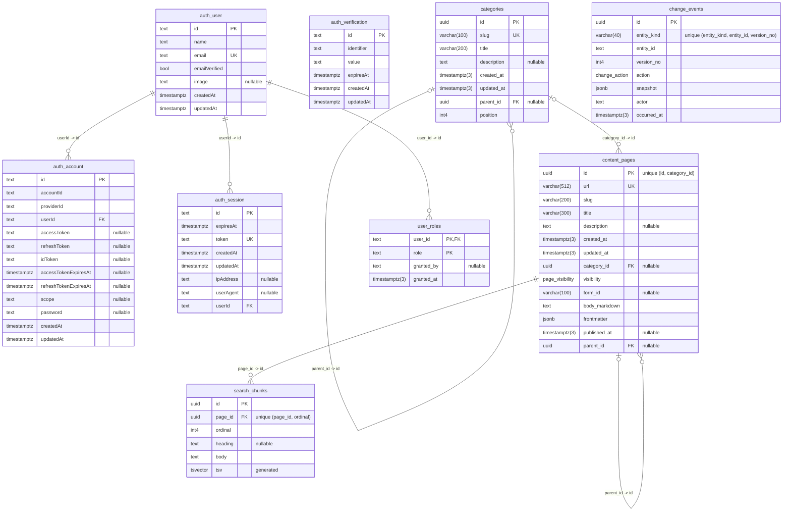

# api_v2

The markdown content API uses Node, Fastify, Drizzle and its own PostgreSQL database. Citizen page resolution stays public. The editor's reads and writes require a GitHub account with a verified email and active membership in `govtech-bb`, authenticated by BetterAuth.

## Run locally

Create `gov_bb_v2`, then copy `.env.example` to `.env` and fill in the authentication settings. `pnpm dev` loads `.env` when it exists; the built server (`pnpm start`) reads only its environment. From this directory:

```sh
pnpm dev
```

Create a [GitHub OAuth App](https://github.com/settings/developers) with homepage URL `http://localhost:3000` and this authorization callback URL:

```text
http://localhost:3020/api/auth/callback/github
```

Use `http://localhost:3000` for the editor and set its public `VITE_API_ORIGIN` to `http://localhost:3020`. Use `localhost` consistently; mixing it with `127.0.0.1` changes the browser's cookie context. The editor offers unauthenticated visitors **Continue with GitHub** and starts OAuth only when they choose it, then returns them to their original editor URL. Authentication does not move or clear existing browser drafts.

Generate `BETTER_AUTH_SECRET` with `openssl rand -base64 32` and keep it stable. Set `GITHUB_CLIENT_ID` and `GITHUB_CLIENT_SECRET` from the GitHub OAuth App. The provider requests `read:user`, `user:email`, and `read:org`; grant the app access to `govtech-bb` if the organization restricts OAuth apps. Missing credentials prevent startup in every environment.

For local development only, `AUTH_BYPASS=true` skips sign-in. BetterAuth is not started, so the credentials above are unused and placeholders will do, and every editor request runs as a fixed local developer. Pair it with the editor's `VITE_AUTH_BYPASS=true`. Under the bypass `API_V2_ADMIN_EMAILS` may be left empty, since the local developer holds every role; otherwise startup refuses without it. Because a bypassed API admits any caller, startup refuses it in production and whenever `EDITOR_ORIGIN` is not `localhost` or `127.0.0.1`.

| Variable                                           | Purpose/default                                                                                                                                                                                                        |
| -------------------------------------------------- | ---------------------------------------------------------------------------------------------------------------------------------------------------------------------------------------------------------------------- |
| `DB_HOST`, `DB_PORT`, `DB_USERNAME`, `DB_PASSWORD` | `localhost`, `5432`, `postgres`, `postgres`                                                                                                                                                                            |
| `DB_NAME`                                          | `gov_bb_v2`                                                                                                                                                                                                            |
| `DB_SSL_CA`                                        | Optional PEM contents or CA file path; production uses verified TLS                                                                                                                                                    |
| `PORT`                                             | `3020`                                                                                                                                                                                                                 |
| `SEED`                                             | `true` loads the committed estate snapshot on boot. Local development only: an additive seed on every boot brings back a page an editor deleted, so no deployed environment may set it, and production refuses to boot |
| `BETTER_AUTH_URL`                                  | Required public API origin                                                                                                                                                                                             |
| `EDITOR_ORIGIN`                                    | Required editor origin; the exact credentialed CORS and write-origin allowlist                                                                                                                                         |
| `BETTER_AUTH_SECRET`                               | Required secret of at least 32 characters                                                                                                                                                                              |
| `GITHUB_CLIENT_ID`, `GITHUB_CLIENT_SECRET`         | Required server-side GitHub OAuth credentials                                                                                                                                                                          |
| `AUTH_BYPASS`                                      | Local development only: `true` skips sign-in (see above)                                                                                                                                                               |
| `PREVIEW_SECRET`                                   | Optional; the site's preview token. Unset, every preview read is refused                                                                                                                                               |
| `API_V2_ADMIN_EMAILS`                              | Required unless `AUTH_BYPASS=true`: comma-separated emails granted the `admin` role whenever they sign in (see Roles). Startup refuses an empty list, since without an admin nobody can grant `approver` (ADR 0079)    |

Production requires HTTPS API/editor origins on the same site, such as separate subdomains of the same organizational domain. Cookies are host-only, HttpOnly, Secure on HTTPS, and SameSite=Lax; API requests from the editor include credentials. Do not enable broad cookie domains or permissive CORS. Register the production API's exact `/api/auth/callback/github` URI in GitHub. Forwarded Host headers do not determine callback URLs; the configured origin does. This change does not configure hosting, DNS, or a reverse proxy.

## Boundaries

`main.ts` is the composition root. It parses configuration, creates one logger and pool, connects, migrates and seeds, then constructs the adapters (`PostgresPages`, BetterAuth or the local bypass), the services over them, and the HTTP app, and on shutdown closes the app before the pool. `src/test-db.ts` composes the same graph for tests.

| Layer             | Directory                  | Owns                                                                                                                                                                               |
| ----------------- | -------------------------- | ---------------------------------------------------------------------------------------------------------------------------------------------------------------------------------- |
| Domain            | `src/modules`              | Page shapes and write rules (placement, publication), what a viewer may see, categories and what they list, service grouping, search text, auth admission. Pure: no I/O, no clock. |
| Application       | `src/services`             | One use case each (`PageResolution`, `SiteNavigation`, `PageEditing`, `CategoryEditing`, `EditorIndex`, `EditorAccess`), with the ports it needs declared beside it.               |
| Outbound adapters | `src/adapters`             | `PostgresPages` (all content SQL, including the recursive hierarchy reads), BetterAuth, the local bypass.                                                                          |
| Inbound adapters  | `src/routes`, `src/app.ts` | Zod request/response contracts, the HTTP mapping of each result.                                                                                                                   |

Category HTTP handlers live in `src/routes/categories.ts`. Its editor plugin is registered inside `src/routes/editor.ts`, so employee, Origin and no-store checks apply before validation. Its public plugin is registered inside `src/routes/site.ts`, so preview admission, cache policy and ETags remain separate from employee access. Both reuse the parent scope's request identity reader; category rules and SQL stay in their existing domain, service and storage owners.

Route plugins receive their services and request identity readers explicitly through plugin options; nothing is decorated onto the Fastify instance and nothing is autoloaded, so dependencies are visible at registration. Expected failures are `Result` values that routes map to status codes; only defects throw. ESLint enforces the direction: domain and services cannot import Fastify, drizzle, pg, BetterAuth, adapters or routes, and routes cannot import infrastructure.

Better Auth verifies the GitHub email, and the API checks `GET /user/memberships/orgs/govtech-bb` using the sign-in token on both first and returning sign-ins. Only `state: active` membership in `govtech-bb` is admitted; pending invitations, missing membership, and failed checks deny access. Any verified email domain is allowed. Password login and client-supplied ID-token sign-in are disabled. Existing users can link GitHub through the same verified email only after passing the membership check; provider trust never bypasses email verification. OAuth tokens are discarded before account persistence. Sessions expire absolutely after eight hours; reads do not extend them. Session cookies are checked against PostgreSQL on every protected request, so revocation takes effect immediately. Organization membership changes are checked on the next GitHub sign-in; existing application sessions must be revoked when immediate removal is required.

Migration `003_auth` adds BetterAuth's four core tables: `auth_user`, `auth_session`, `auth_account`, and `auth_verification`. It does not replace content tables or author data. The migration is checked against the installed BetterAuth schema in the PostgreSQL integration suite. Migration `004_github_sessions` revokes sessions without a linked GitHub account, forcing existing Google users through the new membership check. User IDs, accounts, content, audit history, and browser drafts are preserved. Use the same verified email on GitHub to retain an existing user ID.

### Roles

Signing in decides who is an employee; roles decide what they can do (ADR 0079). Roles are rows in `user_roles` (migration `008_user_roles`, numbered after #3340's 006 and 007), read on every request, so a revocation applies to the employee's next request.

- `editor` writes: creating, saving and deleting pages, and managing categories. Every employee is an editor by default: api_v2 grants the role, with no grantor, when it creates the user at their first sign-in, and migration `009_default_editor_role` granted it once to everyone who had signed in before. It is never granted again, so an admin can revoke it to stop one person writing without removing them from the organisation.
- `approver` changes what citizens see: changing a page's `visibility`, creating a page as `public`, or deleting a `public` page. An editor who isn't an approver can make every other edit.
- `admin` lists employees and grants and revokes roles (`/editor/employees…`), recording who granted each. A signed-in employee whose email `API_V2_ADMIN_EMAILS` lists is granted `admin`, with no grantor, if they lack it; so an admin cannot revoke a listed admin for good.

A refusal is a 403 `{error: "forbidden", message}` and the database is unchanged. Reads stay open to every signed-in employee, roles or not. Each write route names the role it needs in its route options (`config: { role: "editor" }`), and the editor scope's `onRequest` hook enforces it; a write route that names none is refused to everyone, and `src/route-auth.test.ts` fails until it names one.

Under `AUTH_BYPASS` the local developer holds every role. `GET /editor/me` returns the signed-in employee and their roles, which the editor uses to hide what they cannot do.

## Database

Generated from the migrated database by `src/erd.ts`; do not edit it by hand. `src/erd.test.ts` fails when it no longer matches the migrations.

<!-- ERD:START: generated by src/erd.test.ts, do not edit -->



<!-- ERD:END -->

## HTTP surface

| Method   | Path                                | Access                                                                 |
| -------- | ----------------------------------- | ---------------------------------------------------------------------- |
| GET      | `/pages?url=…`                      | Site page resolution (public, or preview with the token)               |
| GET      | `/categories`                       | Site category tree                                                     |
| GET      | `/categories/:slug`                 | A category's subcategories and root pages                              |
| GET      | `/categories/:c/:s`                 | A subcategory's root pages                                             |
| GET      | `/catalog`                          | Every visible page (sitemap, service lists)                            |
| GET      | `/search/documents`                 | Every visible page with its search text in chunks                      |
| GET      | `/docs`                             | Public API reference (Scalar)                                          |
| GET      | `/docs/openapi.json`                | Public OpenAPI document                                                |
| GET      | `/pages/:id`                        | Employee; includes drafts and previews                                 |
| GET      | `/services`                         | Employee service index, grouped by `parent_id`                         |
| GET      | `/services/:id`                     | Employee; one service's pages with their roles, entry first            |
| GET      | `/editor/categories`                | Employee; every shared category, counts, address protection and stamps |
| POST     | `/editor/categories`                | Employee; append a category or subcategory                             |
| PUT      | `/editor/categories/:id`            | Employee; edit with mandatory `if-updated-at`                          |
| PUT      | `/editor/categories/order`          | Employee; reorder a complete expected sibling snapshot                 |
| DELETE   | `/editor/categories/:id`            | Employee; delete an empty category with `if-updated-at`                |
| GET      | `/version`                          | Employee change token                                                  |
| POST     | `/pages`                            | Employee create; as `public`, approver only                            |
| PUT      | `/pages/:id`                        | Employee save, optional `if-updated-at`; `visibility`, approver only   |
| DELETE   | `/pages/:id`                        | Employee delete; a `public` page, approver only                        |
| GET      | `/editor/me`                        | Employee; who is signed in, with their roles                           |
| GET      | `/editor/employees`                 | Admin; everyone who has signed in, with their roles                    |
| PUT      | `/editor/employees/:id/roles/:role` | Admin; grant a role                                                    |
| DELETE   | `/editor/employees/:id/roles/:role` | Admin; revoke a role                                                   |
| GET/POST | `/api/auth/*`                       | BetterAuth's GitHub/session protocol                                   |

Missing, expired, or revoked sessions produce JSON 401 responses; disallowed employees or write origins produce 403; unavailable session verification produces 503. The API does not redirect protected content requests to GitHub. The editor handles navigation. Authenticated writes require `Origin: <EDITOR_ORIGIN>`. Auth/session/editor responses use `Cache-Control: no-store` and do not receive ETags. Page create, save and delete audit rows record the authenticated user ID, never a caller-supplied actor, and commit with the write they record. Category writes do not yet emit events or attributed history; see the release dependency below.

Public site reads (`/pages?url=`, `/categories…`, `/catalog`, `/search/documents`) send `public, max-age=60, stale-while-revalidate=300, stale-if-error=86400`; unknown public URLs send `public, max-age=10`. ETags and 304s remain available for public reads. These routes do not look up or refresh employee sessions.

Preview: the site's server sends its `PREVIEW_SECRET` as `x-preview-token`, and the same reads then include `preview` content. Those responses are `no-store` with no ETag, so preview content never enters a shared cache. A wrong token, or any token when `PREVIEW_SECRET` is unset here, is a 401 rather than a quiet fall-back to the public view. `draft` content is only ever served to the editor.

The hierarchy is `parent_id`, not the url. A page is served only when it and every page above it are visible; its breadcrumbs are its category (and parent category, for a subcategory), then the pages above it; a category lists only the pages at its root (`parent_id` null), so `start` steps and sub-pages never appear in a listing. A sub-page must share its parent's category (moving the parent moves its sub-pages), a page cannot sit beneath itself, and a page with sub-pages cannot be deleted: each is a field-specific 422.

`GET /pages?url=` returns `{url, frontmatter, body_markdown, form_id, hide_start_links, breadcrumbs}`. `hide_start_links` is true when the page's `start` sub-page is hidden from the viewer. Whether a form is open is the forms API's to say: `form_id` is a name, and the site asks the forms API for the form's status. The API serves markdown as written; the site owns sanitization and rendering. Editor writes return field-specific 422s for invalid references or duplicates, 409 for a stale supplied version, and stamp `published_at` only on first publication. A save replaces the page, so it sends every field; only `parent_id` may be left out, which keeps the page's parent. Changing `url` moves that page alone: its sub-pages keep theirs, and nothing redirects from the old url. Each write still records an append-only audit snapshot; page-history readers are no longer exposed. A request its route's schema refuses (a missing field, an id that is not a UUID, an `if-updated-at` that is not a timestamp, a url over 512 characters, a title over 300) is a 400; Fastify's own refusals keep their status (a body that is not JSON is a 415), and an unknown route is a JSON 404.

### Category management

The one shared list serves category management, every page picker and every content
type. `GET /editor/categories` returns `{ categories: [...] }` with each parent
followed by its ordered children. Rows contain `id`, `parent_id`, `title`, `slug`,
nullable `description`, `url`, `position`, `services`, `reserved_route` and
`updated_at`. Service counts match `/services` roots, including unpublished work.
Public category reads expose none of the private counts or editor metadata.
The former taxonomy endpoint is removed without an alias.

Create/update send all four fields:
`{ title, slug, parent_id, description }`. Unknown keys are refused. Titles and
descriptions are trimmed; blank descriptions become null. Names need not be
unique; slugs must be globally unique, lower-case hyphenated words of at most
100 characters. Renaming a title never changes the slug. Empty categories may
change slug/parent, but any assigned page, subcategory or reserved app-route
anchor blocks address changes. Names and descriptions remain editable at anchors.

Create and reparent append to the current destination under the shared content
write lock. Update/delete require the original millisecond `if-updated-at`.
Reorder sends `{ parent_id, expected: [{ id, updated_at }], ordered_ids }` for the
complete sibling group and returns `{ categories: [...] }` in saved order.
Missing/malformed fields or versions are 400; field rules are 422; stale writes
are 409 `conflict`. Occupied deletion is 409 `category_in_use` with
`blockers: { pages, subcategories, reserved_route }`. The page blocker counts
all pages, not just services. No operation cascades deletion or moves page URLs.
A missing category target is 404; successful deletion is 204.

All category writes and page create/save/delete transactions take the same
advisory lock before row locks. They check page/category URL collisions in both
directions, including drafts and empty categories. Existing page operations
otherwise retain their behavior. App-owned route/asset reservations and category
anchors are explicit in `src/modules/category.ts`, with landing route coverage
in its test. The complete contract is [ADR 0078](../../docs/decisions/0078-category-write-rules.md).

Do not automatically retry a mutation whose response was lost or was a 5xx.
The write may already have committed. Refresh and reconcile the saved slug/fields,
sibling order or deleted ID first; a changed timestamp alone does not prove success.

Category writes do not yet emit events or advance `/version`. #3169 owns
trigger-based category events and transaction-local actor attribution; #3171
owns private last-editor reads. There is no temporary category audit log or
polling workaround. The editor's persisted category controls are tracked in
#3178, landing integration in #3179, and sandbox acceptance in #3180.

`search_chunks` holds each page's body split at its headings, as plain text, rewritten in the same transaction as every save. Rejoined, a page's chunks are exactly the text landing's search indexes today (`search-text.test.ts` checks every seeded page), so moving search onto the API does not move its ranking. The generated `tsv` column and its GIN index are there for server-side search and are not read yet.

The seed is a committed snapshot of legacy markdown and the category taxonomy, subcategories included, with each sub-page's parent. Inserts are additive and idempotent and never replace authored changes. It runs only with `SEED=true`, because an additive insert also brings back a page an editor deleted. Each page it adds records a `created` entry by `seed` for the audit log and editor's change token. Regenerate it with `pnpm seed-data` when intentionally updating the snapshot. `pnpm seed-data` also records `source`, the last commit that touched `apps/landing/src/content`, and the one-time import names it in every history entry it writes (see "Importing the estate" below).

## Importing the estate (one-time)

Deployed databases get the estate once, by a command rather than by `SEED`. It is compiled into the image beside `main.js`, so it runs with the task's own database settings:

```sh
node dist/src/import-estate.js [--dry-run] [--force "<reason>"]
```

Locally, from this directory, run `pnpm import-estate --dry-run` or `pnpm import-estate`; it reads `.env` like `pnpm dev`. Do not add a `--` separator: this pnpm forwards it literally and tsx then rejects the flag.

The command migrates first, prints `database: <name> host: <addr>` before writing anything, then one JSON line: `{"mode":"dry-run"|"import"|"replace","existing":N,"actors":{…},"categories":N,"documents":N}`. It refuses, with exit code 1, when `content_pages` already has rows: `content_pages has N rows (history actors: …); refusing. Pass --force "<reason>" to replace them.` `--force` truncates `search_chunks`, `content_pages` and `categories` and then imports, all in one transaction; `change_events` is never truncated. The transaction holds a lock on `content_pages` until it commits or rolls back, so editor saves stall for the few seconds it takes, and a forced run (which truncates) stalls public reads for that time too. `--dry-run` does the real work and rolls it back, so its counts and errors are real. Every imported page's `created` history entry is by `import:<source sha>`, with ` force: <reason>` appended when forced.

### Per environment

Do sandbox first, then staging and prod once their api_v2 services exist.

1. Refresh the snapshot: merge `main` into `v2-rewrite`, run `pnpm seed-data`, commit `estate.json`, merge, and let the deploy build the image. The `source` sha in that commit is what the audit log records.
2. Confirm the task definition does not set `SEED`: `aws ecs describe-task-definition --task-definition api-v2-<env> --query 'taskDefinition.containerDefinitions[0].environment'`. If it does, see #3052.
3. Run the command inside the live container with ECS Exec (needs the AWS Session Manager plugin and credentials for the account). The deployed image has no `psql`, so every database step goes through the command. Dry run first; read the `database:` line and the counts; then the real run.

   ```sh
   export AWS_PROFILE=<your profile>
   export AWS_REGION=ca-central-1
   CLUSTER=modular-forms-sandbox
   SERVICE=api-v2-sandbox
   TASK=$(aws ecs list-tasks --cluster "$CLUSTER" --service-name "$SERVICE" --query 'taskArns[0]' --output text)
   aws ecs execute-command --cluster "$CLUSTER" --task "$TASK" --container api-v2 --interactive --command /bin/sh
   ```

   Then, inside that shell:

   ```sh
   node dist/src/import-estate.js --dry-run
   node dist/src/import-estate.js
   ```

   and for a forced run inside the same shell:

   ```sh
   node dist/src/import-estate.js --force "sandbox rehearsal: replace SEED=true content"
   ```

   A one-shot form also works when the command needs no quoting, e.g. `--command "node dist/src/import-estate.js --dry-run"`; for a forced run as a one-shot, wrap it as `--command "/bin/sh -c 'node dist/src/import-estate.js --force \"<reason>\"'"` and confirm the quoting on the sandbox rehearsal before relying on it.

4. Record it: run `--dry-run` once more. It refuses and prints `history actors:`, which is the ledger: `import:<sha>=116` after a plain import, or `import:<sha> force: <reason>=116` alongside the old `seed=116` after a forced replace (the sandbox rehearsal). The `change_events` rows carry `occurred_at` and the sha names the markdown commit.
5. Smoke from your machine. Every `public` page in `estate.json` returns 200 from `GET /pages?url=`; `preview` pages return 200 only with the `x-preview-token` header (the task's `PREVIEW_SECRET`); `draft` pages are never served by that endpoint.

   ```sh
   API=https://<api origin>
   jq -r '.pages[] | select(.visibility == "public") | .url' apps/api_v2/src/seed-data/estate.json |
     while read -r url; do
       code=$(curl -s -o /dev/null -w '%{http_code}' --get --data-urlencode "url=$url" "$API/pages")
       [ "$code" = 200 ] || echo "$code $url"
     done
   ```

### A database that already has content

#3095 contains the sandbox rehearsal and snapshot evidence; #3234 tracks the later refresh. The production `SEED` guard is implemented (#3052). An open issue is not a reason to repeat an import. Verify the target task definition and recorded source/actor evidence before any separately approved environment work.

`--dry-run` refuses an occupied database and shows its page-event actor histogram. That histogram cannot prove that no editor has changed categories: category writes do not emit events until #3169 lands. Do not use `seed`/`spike` actors alone as permission to force-replace an estate. Preserve editor-owned data; fix forward in the editor, or use an approved RDS point-in-time recovery to a moment before a bad import.

### The markdown freeze

`apps/landing/src/content` freezes at the prod import. Until then it stays editable, and the snapshot is regenerated before each environment's import (step 1). After the prod import, content changes go through the editor only; delete the directory once landing_v2 is the only reader.

## Operations and tests

SIGINT/SIGTERM drain HTTP requests before closing the shared pool; startup failures also release acquired resources. JSON logs omit cookies, OAuth callback query parameters, provider tokens and raw driver error objects. The exact warning `idle database connection dropped` remains the operational alarm marker; its safe `code` identifies the failure. Public content failures continue to use the existing 500 response, while authentication outages fail closed with 503.

Migrations run at boot. Each script commits with its `schema_migrations` row under a PostgreSQL advisory lock, so instances that boot together apply them one at a time; every script must be safe to replay, because an instance that waited on the lock runs it again.

```sh
pnpm exec nx run api_v2:build
pnpm exec nx run api_v2:typecheck
pnpm exec nx run api_v2:test
DB_HOST=localhost pnpm exec nx run api_v2:e2e
```

Unit/integration tests run against PostgreSQL (`DB_HOST` etc., defaulting to `localhost:5432` as `postgres`/`postgres`): the global setup migrates one template database per run and each test clones it, dropping it afterwards. There is no skip; with no database the run fails and says so. CI's Test job provides a `postgres` service. PostgreSQL e2e creates and drops uniquely named scratch databases and exercises the compiled Node process, migrations, cookie sessions, session expiry/revocation, origin protection, audit identity, pool recovery and shutdown. Test sessions are created through the real BetterAuth internal adapter in test code; no production login bypass exists. The e2e suite skips when `DB_HOST` is unset. OAuth provider admission and the sign-in handshake are tested without live GitHub credentials; deployment still requires a real GitHub sign-in and TLS smoke check.

`openapi.json` is a file snapshot of the document the running app generates from its route schemas (`src/routes/contracts.ts`), so `src/openapi.test.ts` fails when the two differ. It is served at `/docs/openapi.json`, with a browsable reference at `/docs`. Update it from this directory with `pnpm exec vitest run src/openapi.test.ts -u`.

The diagram under "Database" is the same kind of snapshot, of the tables the migrations create, so `src/erd.test.ts` fails when a migration changes a table without it. Refresh it from this directory with `pnpm exec vitest run src/erd.test.ts -u`.
